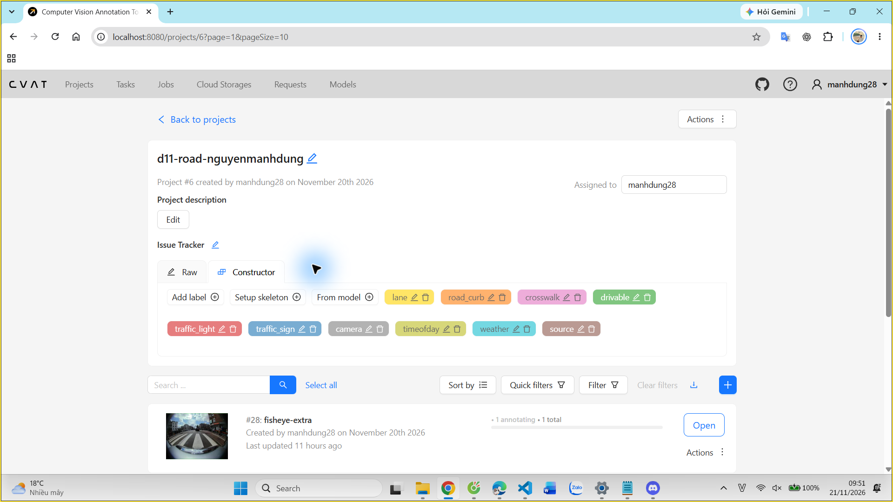
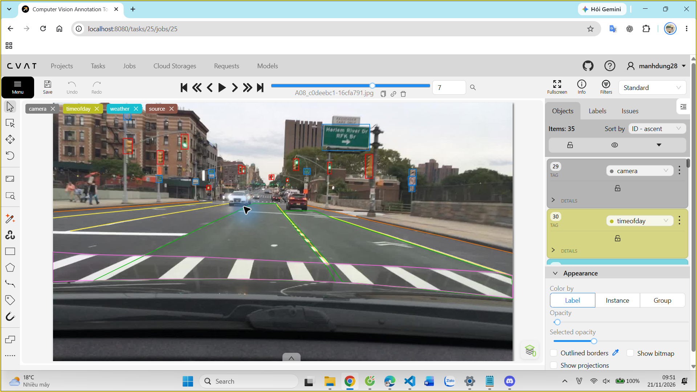
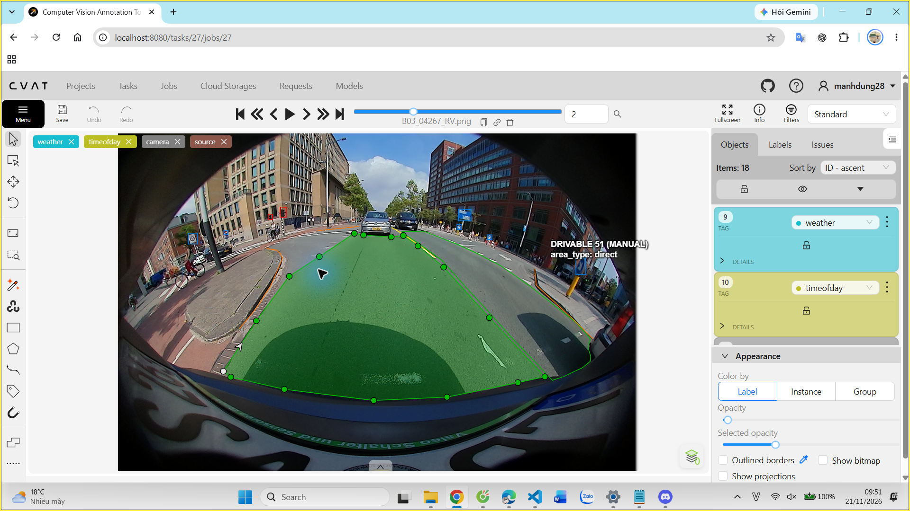
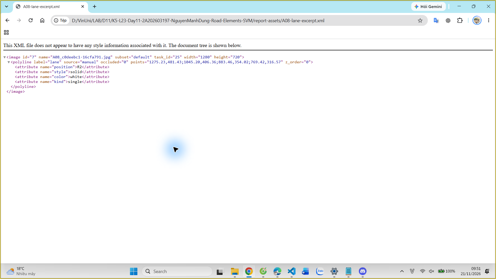

# Báo cáo cá nhân — Ngày 11
Họ tên: Nguyễn Mạnh Dũng    Mã học viên: 2A202603197  
Phiên bản CVAT (Help → About): 2.82.0  
Guideline: Road v1.0    Lần nộp (`revision` trong manifest): 1  
Mốc thời gian ghi báo cáo: 20/11/2026 23:00 (UTC+7)  
Thời điểm export (ngày giờ trên CVAT): 21/11/2026 10:08:49 (UTC+7)    Số lần nộp lại sau Rework: Chưa ghi nhận lần nộp lại.  

## 1. Kiểm project
| Mục | Đúng như guideline Road v1.0? | Ghi chú |
| --- | --- | --- |
| 6 label, đúng kiểu | Có | 2 polyline, 2 polygon, 2 rectangle |
| Thuộc tính và giá trị | Có | Khớp cấu hình Road v1.0 |
| 4 tag ảnh | Có | 28/28 ảnh có đủ camera, timeofday, weather, source |
Cách kết thúc polyline trên bản CVAT này: Bấm **N** sau khi đặt điểm cuối.  
Cách đặt tag ảnh trên bản CVAT này: Chọn **Tag** ở thanh trái, sau đó mở **Objects → Details** để chỉnh giá trị.  

## 2. Số lượng đã gán
| Task | Ảnh | lane | road_curb | crosswalk | drivable | traffic_light | traffic_sign |
| --- | ---: | ---: | ---: | ---: | ---: | ---: | ---: |
| front | 12 | 36 | 19 | 5 | 28 | 31 | 27 |
| front-extra (đã làm 4 / 4) | 4 | 11 | 6 | 7 | 8 | 7 | 13 |
| fisheye | 8 | 9 | 20 | 11 | 13 | 8 | 7 |
| fisheye-extra (đã làm 4 / 4) | 4 | 0 | 6 | 5 | 6 | 0 | 0 |

## 3. Bảng ca khó
| Ảnh | Nhãn | Phân vân giữa | Đã chọn | Lý do |
| --- | --- | --- | --- | --- |
| Chưa ghi mã ảnh | crosswalk | Bao cả cụm vạch qua phần bị chắn hay chỉ vẽ phần vạch nhìn thấy | Tôi chỉ vẽ phần vạch nhìn thấy, tránh đè lên chân người đi bộ hoặc cột che. | Tôi bám phần vạch nhìn rõ. Guideline chưa nêu cách xử lý khi cụm vạch bị che, nên cần hỏi coach nếu phải tách polygon. |

## 4. Phiếu QC 1 nhận được
Bạn kiểm lô của tôi: Hoàng Quốc Mạnh. Quyết định nhận được: **Rework** (21/11/2026). Phiếu ghi 1 lỗi nặng, 8 lỗi chính trên 104 nhãn (7,7%), 1 lỗi nhẹ và 8 ca chờ lead.  
Mạnh kiểm `front_nmd.zip` của task 25, xuất lúc 09:27 ngày 21/11/2026 (UTC+7), trước bản export đang dùng trong báo cáo.

| Mã lỗi | Số lỗi | Đồng ý? | Đã sửa? |
| --- | ---: | --- | --- |
| QC1-03 | 1 nặng | Có. Vạch bên phải ở A10 bị gán L1. | Đã sửa thành `R1` và xác nhận trong ZIP hiện tại. |
| QC1-05 | 4 chính | Cần rà cách vẽ vạch đôi ở A04, A06, A09 và A11. | Bản hiện tại vẫn có hai polyline ở các vị trí bị nêu. |
| QC1-07 | 1 chính | Cần rà lại ranh giới `direct` và `alternative` ở A12. | Chưa xác nhận đã sửa. |
| QC1-08 | 1 chính | Cần đối chiếu cụm đèn ở góc trên trái A06. | Chưa xác nhận đã bổ sung. |
| QC1-09 | 2 chính | Có. Biển ONE WAY thuộc nhóm hiệu lệnh. | Đã đổi cả hai biển ở A06 và A12 thành `mandatory` và kiểm tra trong ZIP mới. |
| QC1-01 (tag weather) | 1 nhẹ | Có. Mặt đường A10 ướt rõ. | Đã đổi thành `rain` và kiểm tra trong ZIP mới. |

## 5. Kiểm file export
| File | Mở lại được? | Số shape ảnh 1 (job / file) | Số shape ảnh 2 (job / file) | Tag camera có trong XML? |
| --- | --- | --- | --- | --- |
| nguyenmanhdung-front.zip | Có | 10 / 10 | 8 / 8 | Có |
| nguyenmanhdung-fisheye.zip | Có | 5 / 5 | 6 / 6 | Có |

Lần lint này còn 6 cảnh báo `QC1-02`. A05 cần rà `L1` và `R1`, A07 cần rà `L1`, còn A06, A09 và A14 cần rà `R1`. Tôi đã rà lại các vị trí này nhưng chưa xác định được vạch đủ rõ để gán thêm. Manifest vẫn ghi 6 cảnh báo nặng `QC1-02`.

## 6. Ảnh chụp màn hình

**Cấu hình 6 label và 4 tag trong project CVAT.**

**A08, job 25. Vạch làn, vùng lái, đèn và biển báo.**

**B03, job 27. Ảnh fisheye sau phóng to, thấy polyline cong theo mép lề.**

**Đoạn XML trích từ bản export front, gồm polyline lane của A08.**

## 7. Tự đánh giá
Lỗi bạn mắc nhiều nhất hôm nay (theo mã QC1-xx), và cách tránh ở Ngày 20: Tôi hay nhầm trái và phải khi gán thuộc tính `position` cho vạch làn trên ảnh fisheye trước và sau (QC1-03). Lần sau tôi sẽ kiểm hậu tố tên ảnh (`FV` là camera trước, `RV` là camera sau), đối chiếu tag `camera`, rồi xác định làn xe mình và rà lại `L1`/`R1` trước khi lưu.  
Nhãn của bạn đi vào model ở đâu? Chọn một lỗi đã sửa và nói nó làm model học sai thế nào: Polyline và thuộc tính `position` là nhãn đích cho bài toán nhận diện vạch làn. Trong lần rà bài, vạch bên phải ở A10 được sửa từ `L1` thành `R1`. Trước khi sửa, polyline đã nằm bên phải làn xe nhưng thuộc tính lại chỉ phía trái, khiến mô hình nhận tín hiệu sai về vị trí vạch.  

## 8. (Tùy chọn, buffer) Từ polyline đến đích row-anchor

Phần tự chọn không trình bày trong báo cáo này.
